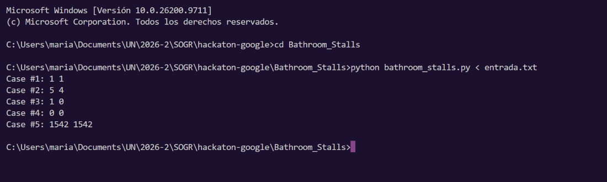
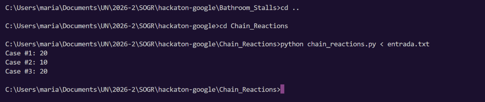
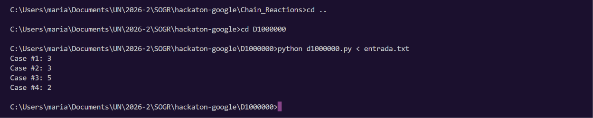
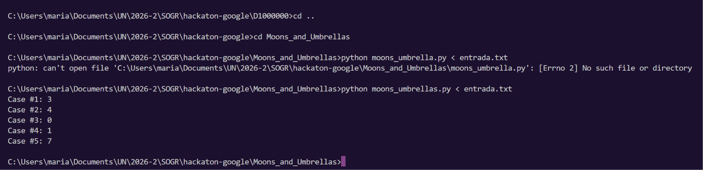
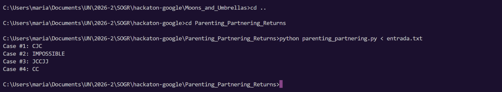

# Hackatón individual: Google Code Jam

Este repositorio contiene soluciones en Python para cinco problemas de
programación competitiva del estilo Google Code Jam. Cada programa lee los
datos desde la entrada estándar y escribe el resultado en la salida estándar,
con el formato `Case #x: ...`.

## Estructura del proyecto

```text
.
├── Bathroom_Stalls/
├── Chain_Reactions/
├── D1000000/
├── Moons_and_Umbrellas/
└── Parenting_Partnering_Returns/
```

Cada carpeta contiene:

- Un archivo `.py` con la solución.
- `entrada.txt`, con un caso de prueba.
- `salida_esperada.txt`, con el resultado esperado.
- `entrada_oficial.txt`, con el caso de prueba "oficial" asignado.

## Ejercicios resueltos

### A. Bathroom Stalls

Archivo: `Bathroom_Stalls/bathroom_stalls.py`



### B. Chain Reactions

Archivo: `Chain_Reactions/chain_reactions.py`



### C. D1000000

Archivo: `D1000000/d1000000.py`



### D. Moons and Umbrellas

Archivo: `Moons_and_Umbrellas/moons_umbrellas.py`



### E. Parenting Partnering Returns

Archivo: `Parenting_Partnering_Returns/parenting_partnering.py`



## Resultado de los ejemplos

Los resultados de referencia están guardados en cada archivo
`salida_esperada.txt`. Para revisar una solución, ejecútala con su
`entrada.txt` y compara la salida obtenida con ese archivo.